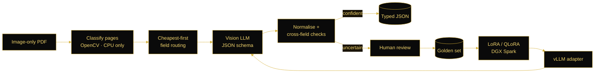

<!-- Profile README · Mohamad Ayham Ayan · colors: #0A0A0A black · #D4AF37 gold · #F5D76E light gold -->

<div align="center">


<a href="https://github.com/mayhamayan748-eng">

</a>

<p>
<a href="https://www.linkedin.com/in/ayham-ayan-02bba1203"></a>
<a href="mailto:mayhamayan748@gmail.com"></a>
<a href="https://mayhamayan748-eng.github.io/"></a>
<a href="https://mayhamayan748-eng.github.io/ar/"></a>
</p>

</div>

### ⚡ Recruiter quick scan

<div align="center">

| 🎯 Role | 🧑‍💻 Experience | 🛠️ Core stack | 🌍 Location |
|:---:|:---:|:---:|:---:|
| AI/ML Engineer<br/><sub>Document AI · Computer Vision · LLMs & Agents</sub> | **AI/ML Engineer at Metamas**<br/><sub>Applied AI Pod · Jul 2026 → now</sub> | Python · FastAPI · Celery · Temporal<br/><sub>Qwen3.5-VL · vLLM · YOLO26 · InsightFace</sub> | Aleppo, Syria · UTC+3<br/><sub>Arabic & English</sub> |

<sub><b>Keywords:</b> AI/ML Engineer · Document AI · Vision LLMs · LoRA / QLoRA · vLLM · Computer Vision · Face Re-ID · Multi-Agent Systems · RAG · Text-to-SQL · FastAPI · Celery · Temporal · NVIDIA DGX Spark</sub>

</div>

---

### 👋 About me

I build **AI systems that cover the full loop**, from data and fine-tuning to evaluation and a tested API.

- 🏭 **Now:** AI/ML Engineer in the Applied AI Pod at **Metamas**, building document AI, computer vision and LLM systems.
- 🔁 **The loop I own:** spec-driven VLM extraction → golden-set annotation → LoRA/QLoRA fine-tuning → vLLM serving on an NVIDIA DGX Spark → per-field evaluation in W&B.
- 🧱 **How I ship:** containerised FastAPI services, Celery or Temporal for long-running work, and tests that run without a GPU or API key.
- 🌍 Aleppo, Syria · Arabic (native) & English

### 📊 Impact in numbers

<div align="center">

| <h2>123</h2> | <h2>5–6</h2> | <h2>183</h2> | <h2>1,130</h2> | <h2>100/100</h2> |
|:---:|:---:|:---:|:---:|:---:|
| fields across 31 doc types<br/><sub>from one declarative catalog</sub> | VLM calls per 5-page doc<br/><sub>CPU page classification first</sub> | reviewed golden-set docs<br/><sub>for LoRA data and evaluation</sub> | automated tests<br/><sub>no GPU or API key needed</sub> | capstone grade<br/><sub>IDP flow forecasting</sub> |

</div>

---

### 🚀 Featured work

<sub>Most of this was built at Metamas. The code is private; the descriptions and numbers are mine. Click a project to expand it.</sub>

<details open>
<summary><b>📄 Document-AI Platform for Arabic Work Orders</b> · spec-driven VLM extraction</summary>
<br/>

Turns image-only Arabic PDFs into typed, section-structured JSON, and closes the loop back into fine-tuning.

`FastAPI` `Celery` `Redis` `PostgreSQL` `Gemini` `Qwen3.5-VL` `Unsloth` `vLLM` `W&B` `Docker`

- 📚 One declarative catalog of **123 fields across 31 document types** generates every prompt and JSON schema, so a new type needs no engine change
- 💸 CPU-only page classification (OpenCV template matching, HSV masks) and cheapest-first field routing hold cost to **5–6 VLM calls per 5-page document**
- 🧾 Deterministic normalisation, cross-field checks and typed issues send uncertain documents to human review
- 🔁 An annotation UI replays recorded model calls into a **183-document golden set**, then exports LoRA datasets for Qwen3.5-VL (4B/9B), served with vLLM behind an OpenAI-compatible API
- 🧪 Per-field evaluation (DocScore, straight-through-processing rate, critical-field pass rate) in W&B; 8 Docker services, 52 API paths, **1,130 tests**



</details>

<details>
<summary><b>🦺 Real-Time PPE Compliance Monitoring</b> · YOLO26 + InsightFace</summary>
<br/>

Worksite monitor built around a crop-then-detect pipeline, for uploaded video and live streams.

`YOLO26` `InsightFace` `FastAPI` `Celery` `Redis` `WebSocket` `React` `Docker`

- 🧍 A YOLO26 pose model finds each worker, then a fine-tuned YOLO26 PPE detector checks the crop
- 🚦 Tri-state machine (compliant · violation · **indeterminate**) with a grace window confirms violations
- 📡 Live RTSP or browser-camera streams over WebSocket; a latest-wins frame buffer keeps latency flat
- 🪪 SCRFD + ArcFace re-ID against an enrolled gallery, with quality-weighted embeddings per track
- 🏋️ Fine-tuned YOLO26s on DGX Spark (MuSGD, cosine LR, mosaic/mixup/copy-paste, 150 epochs), exported to NMS-free ONNX

</details>

<details>
<summary><b>📐 VLM Inspection-Rule Extraction</b> · engineering standards → yes/no checks</summary>
<br/>

Turns construction-standard PDFs into atomic, citation-backed rules, each one a yes/no question a VLM can check against a site photo.

`Temporal` `PostgreSQL` `Alembic` `OpenRouter` `PyMuPDF` `React`

- 🔁 Multi-pass extraction (index, batched extraction, duplicate sweep, verification) as Temporal workflows
- 🔎 Every cited quote is string-matched against its source page
- ⚖️ Versioned prompts and profiles, live cost estimates and LLM-as-judge comparison across runs

</details>

<details>
<summary><b>🤖 Multi-Agent Guest Operations Copilot</b> · Google ADK · Temporal</summary>
<br/>

Five agents (orchestrator, reservation, policy, response, review/safety) handle each guest message inside a durable workflow that waits for human approval.

`Google ADK` `Temporal` `FastAPI` `PostgreSQL` `LiteLLM` `React`

- 🧷 Facts come only from tool results, never from model text
- 🛑 A deterministic decision gate can only make outcomes stricter
- 🧪 Offline agent evals, idempotent ingestion and switchable providers (Gemini, Cohere, OpenRouter)

</details>

<details>
<summary><b>💬 Chat with Your Data</b> · fully local Text-to-SQL RAG</summary>
<br/>

Arabic/English natural-language interface to an Oracle 19c database with schema-aware retrieval. Runs fully on-premise, so no data leaves the server.

`Qwen (local)` `LlamaIndex` `Qdrant` `Oracle 19c`

</details>

<details>
<summary><b>🧰 More tools</b> · SAM 3 auto-labeller · camera calibration app</summary>
<br/>

- 🏷️ **SAM 3 auto-labeller:** a text prompt turns a folder or ZIP of images into a ready YOLO dataset, as a PyQt6 desktop app or a Dockerised web app with a GPU Celery worker
- 📷 **Tilt-compliance web app:** GeoCalib single-image calibration plus OWLv2 zero-shot detection checks an object's tilt against a tolerance; per-model locks, non-root CPU/GPU Docker, pytest and Vitest in GitLab CI

</details>

---

### 🔬 Engineering case studies

<sub>Real problems from my work, described without confidential details.</sub>

<details>
<summary><b>💸 Keeping VLM cost flat on long Arabic documents</b> · routing · OpenCV</summary>
<br/>

**Problem:** calling a Vision LLM for every page and every field multiplies cost with document length.

**Approach:** cheap code decides first. CPU-only page classification (template matching, HSV masks) finds the pages that matter, and fields are routed cheapest-first, so the VLM only sees what nothing cheaper can read. Deterministic normalisation and cross-field checks catch the rest, and anything uncertain becomes a typed issue for human review.

**Result:** **5–6 VLM calls per 5-page document**.

</details>

<details>
<summary><b>🪪 Stable identities from noisy faces</b> · InsightFace · tracking</summary>
<br/>

**Problem:** matching one face crop per frame flickers between identities, and a distant or half-visible worker can't be judged fairly.

**Approach:** aggregate quality-weighted ArcFace embeddings per track before matching against the gallery, and add a third state, **indeterminate**, with a grace window before a violation is confirmed.

</details>

<details>
<summary><b>🧱 Crash-safe, verifiable LLM extraction</b> · Temporal · citations</summary>
<br/>

**Problem:** long multi-pass extractions fail halfway, and re-running them pays for finished batches again. LLMs also invent quotes.

**Approach:** each pass is a Temporal workflow, so a crashed worker resumes without re-paying for finished batches. Every cited quote is string-matched against its source page before a rule is kept.

</details>

<details>
<summary><b>🛑 When the LLM reviewer approved a gas leak</b> · agents · safety</summary>
<br/>

**Problem:** an LLM review agent can approve a reply it should have escalated.

**Approach:** a deterministic decision gate after the agents that can only make outcomes **stricter**, never looser.

**Result:** in testing it escalated a gas-leak report that a real LLM reviewer had approved.

</details>

---

### 🧰 Tech stack

<div align="center">


</div>

<details>
<summary><b>See the full stack by area</b></summary>
<br/>

| Area | Tools |
|---|---|
| **LLMs, VLMs & Agents** | Qwen3.5-VL, Gemini, LoRA/QLoRA (Unsloth), vLLM, structured outputs & JSON schemas, Google ADK, LiteLLM, OpenRouter, LLM-as-judge |
| **RAG** | LlamaIndex, Qdrant, Text-to-SQL, local LLM deployment |
| **Computer Vision** | YOLO (v8 / 11 / 26), pose estimation, InsightFace (SCRFD, ArcFace), SAM 3, OWLv2, GeoCalib, OpenCV, ONNX |
| **ML & Evaluation** | PyTorch, TensorFlow, scikit-learn, golden-set evaluation, W&B, SHAP, cross-validation |
| **Backend & Orchestration** | FastAPI, WebSocket, Celery, Redis, Temporal, PostgreSQL, SQLAlchemy, Alembic, Pydantic, PyMuPDF |
| **Infra & Tools** | Docker / Compose, NVIDIA DGX Spark (GB10), GitLab CI, pytest, React, PyQt6, Git, Jupyter |
| **Languages** | Python, SQL, TypeScript, C# |

</details>

---

### 🎓 Education

<div align="center">

| 🎓 **B.Sc. Information Technology Engineering** · University of Aleppo · 2025 | 🏅 **Applied AI & ML Programme** · Tamkin for IT / Midad · capstone 100/100 |
|:---:|:---:|

</div>

### 💭 How I think

```python
class Ayham(AIEngineer):
    mission = "Ship AI systems you can measure, trust and resume."

    principles = [
        "Spec first: one catalog drives prompts, schemas and evals.",
        "Spend model calls only where cheap code can't decide.",
        "Evaluate per field against a golden set.",
        "Uncertain? Route it to a human instead of guessing.",
    ]

    def on_new_problem(self) -> str:
        return "Build it, measure it, then fine-tune it."
```

---

<div align="center">

### 🤝 Let's connect

Interested in **AI/ML engineering**, **Document AI** and **computer vision** roles

<a href="https://www.linkedin.com/in/ayham-ayan-02bba1203"></a>
<a href="mailto:mayhamayan748@gmail.com"></a>
<a href="https://mayhamayan748-eng.github.io/"></a>


</div>
